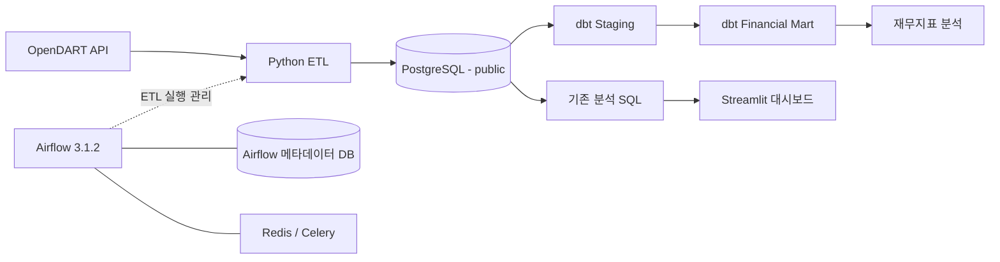

# FDE — 기업 재무 데이터 파이프라인

OpenDART의 기업정보와 재무제표를 수집하고, PostgreSQL에 적재한 데이터를 dbt로 모델링하며, SQL과 Streamlit으로 분석하는 데이터 엔지니어링 포트폴리오입니다.

API 응답을 화면에 표시하는 데서 나아가 **수집 → 검증 → 적재 → 워크플로 실행 → 데이터 모델링 → 분석 → 시각화**의 전체 흐름을 구현했습니다.

v1.2까지 로컬 환경에서 데이터 수집, 증분 적재, 실패 복구, 데이터 모델링 및 품질 검증을 구현했습니다.

## 1. 구현 결과

| 항목 | 결과 |
|---|---|
| 기업정보 | 3,998개 기업 적재 |
| 재무제표 | 5개 기업의 2025년 연결재무제표(CFS), 계정 행 1,281건 적재 |
| 수집 대상 | 삼성전자, SK하이닉스, 현대자동차, NAVER, LG전자 |
| 보고서 | 사업보고서(`reprt_code=11011`) |
| 워크플로 | Airflow DAG의 태스크 4개 실행 성공 |
| 증분 적재 | 수집 상태 기반 SUCCESS 건너뛰기 및 FAILED 재처리 |
| 데이터 모델링 | dbt Staging VIEW 2개, Financial Mart TABLE 1개 |
| dbt 데이터 품질 | Source 테스트 6개, Mart 테스트 8개 통과 |
| Python 테스트 | 15개 통과 |
| 대시보드 | 기업별 재무지표 표 및 매출액·영업이익·영업이익률 차트 표시 |

### 테스트 결과

| 테스트 | 결과 |
|---|---|
| Python 테스트 | 15 PASS |
| dbt Source 테스트 | 6 PASS |
| dbt Mart 테스트 | 8 PASS |
| **전체 자동화 테스트** | **29 PASS** |

dbt 전체 빌드 결과:

```text
3 models
14 data tests

PASS=17
WARN=0
ERROR=0
SKIP=0
```

위 결과는 개발 환경에서 확인한 실행 결과입니다.

1,281건은 보고서 수가 아닌 재무제표 **계정 행 수**이며, 데이터 건수는 수집 시점과 공시 변경에 따라 달라질 수 있습니다.

별도의 처리량·응답시간 벤치마크는 수행하지 않았습니다.

---

## 2. 아키텍처



데이터 파이프라인은 수집·적재 계층과 분석용 데이터 모델링 계층으로 구분됩니다.

### 2-1. 수집 및 적재 — Python ETL

OpenDART API에서 기업정보와 재무제표를 수집하고, 검증 후 PostgreSQL `public` 스키마에 적재합니다.

| 테이블 | 역할 |
|---|---|
| `companies` | 기업 기본정보 |
| `financial_statements` | 재무제표 계정별 데이터 |
| `financial_collection_status` | 기업별 재무제표 수집 상태 |
| `pipeline_runs` | 파이프라인 실행 이력 |
| `schema_migrations` | DB 마이그레이션 이력 |

### 2-2. 데이터 모델링 — dbt

PostgreSQL 원본 데이터를 dbt로 변환하여 분석용 데이터 모델을 생성합니다.

| 계층 | 모델 | Materialization |
|---|---|---|
| Source | `public.companies` | PostgreSQL 원본 테이블 |
| Source | `public.financial_statements` | PostgreSQL 원본 테이블 |
| Staging | `stg_companies` | VIEW |
| Staging | `stg_financial_statements` | VIEW |
| Mart | `mart_financial_summary` | TABLE |

dbt 모델은 `fde_dev` 스키마에 생성됩니다.

Financial Mart는 기업·사업연도·보고서·연결/별도 재무제표를 기준으로 매출액, 영업이익, 당기순이익 및 이익률을 제공합니다.

### 2-3. 데이터 품질 검증

dbt의 Generic Test와 Singular Test를 이용하여 다음 항목을 검증합니다.

- Source 기본키 NULL 및 중복 검사
- 기업정보와 재무제표 간 참조 무결성 검사
- Financial Mart 핵심 컬럼 NULL 검사
- 기업·사업연도·보고서·재무제표 구분 기준 복합키 중복 검사

총 14개의 dbt 데이터 품질 테스트를 구현했으며, 전체 테스트가 통과했습니다.

### 2-4. 워크플로 및 시각화

- **Airflow:** Docker Compose 환경에서 Python ETL 실행과 재시도를 관리합니다.
- **PostgreSQL:** 원본 데이터와 dbt 분석 모델을 저장합니다.
- **Redis:** Airflow CeleryExecutor의 메시지 브로커입니다.
- **Streamlit:** 기존 분석 SQL을 사용하여 재무 데이터를 시각화합니다.

현재 Airflow는 Python ETL을 실행하며, dbt 실행 자동화는 아직 통합하지 않았습니다.

또한 Streamlit은 기존 분석 SQL을 사용하며, dbt Mart와의 직접 연결은 후속 개선 대상입니다.

---

## 3. 기술 스택

| 기술 | 사용 목적 |
|---|---|
| Python 3.12 | API 호출, XML 파싱, 금액 변환 및 ETL 구현 |
| requests / python-dotenv | HTTP 요청과 환경변수 로드 |
| PostgreSQL 17 / psycopg 3 | 관계형 데이터 저장, 트랜잭션, UPSERT |
| Apache Airflow 3.1.2 | 태스크 의존성, 재시도, 정기 실행 관리 |
| Docker Compose / CeleryExecutor / Redis | Airflow 실행 환경 및 작업 실행 구성 |
| dbt Core 1.12.6 | SQL 기반 데이터 모델링 및 변환 |
| dbt-postgres 1.11.0 | PostgreSQL용 dbt 어댑터 |
| SQL | 재무제표 계정 집계, 재무지표 계산 및 데이터 분석 |
| pandas / Streamlit | 조회 결과 변환 및 대시보드 구현 |
| pytest | 수집·검증·증분 적재 관련 테스트 코드 |

개발 환경의 FDE DB는 PostgreSQL 17이며, Airflow 메타데이터 DB는 PostgreSQL 16입니다.

로컬 의존성은 `requirements.txt`에 기록되어 있습니다.

Airflow 이미지는 `Dockerfile`에서 별도로 빌드하며, ETL에 필요한 psycopg·requests·python-dotenv를 추가 설치합니다.

dbt는 로컬 Python 가상환경에서 실행하며, 현재 Airflow DAG와 자동으로 연동되어 있지 않습니다.

---

## 4. 프로젝트 구조

```text
FDE/
├── dags/
│   └── fde_pipline.py              # DAG ID: fde_daily_pipeline
├── src/
│   ├── corp_list.py                # 기업 목록 수집 및 실행 이력 기록
│   ├── collector.py                # 개별 기업 상세정보 수집
│   ├── validator.py                # 개별 기업정보 검증
│   ├── database.py                 # 기업정보 UPSERT와 실행 이력 관리
│   ├── db_config.py                # 로컬·Docker DB 설정
│   ├── financial_collector.py      # 재무제표 수집·변환·UPSERT
│   └── dashboard.py                # Streamlit 대시보드
├── fde_dbt/
│   ├── dbt_project.yml
│   ├── models/
│   │   ├── staging/
│   │   │   ├── sources.yml
│   │   │   ├── stg_companies.sql
│   │   │   └── stg_financial_statements.sql
│   │   └── marts/
│   │       ├── mart_financial_summary.sql
│   │       └── schema.yml
│   └── tests/
│       └── assert_mart_financial_summary_unique.sql
├── scripts/
│   └── migrate.py
├── sql/
│   ├── bootstrap/
│   │   └── create_schema_migrations.sql
│   ├── migrations/                 # 001~008 스키마 변경 SQL
│   └── queries/
│       └── financial_analysis.sql
├── tests/                          # Python 단위·DB 연동 테스트
├── docs/
│   └── DEVELOPMENT_LOG.md
├── data/
│   └── companies.csv
├── Dockerfile
├── docker-compose.yaml
├── requirements.txt
└── README.md
```

---

## 5. 핵심 기능

### 5-1. 기업정보 수집과 증분 적재

`corpCode.xml` 응답의 ZIP을 메모리에서 해제하고 XML을 파싱합니다.

종목코드가 있는 기업을 추출한 뒤 `corp_code`를 기준으로 기존 데이터와 비교합니다.

- 신규 기업은 INSERT합니다.
- 기업명 또는 종목코드가 변경된 기업은 UPDATE합니다.
- 변경 없는 기업은 쓰기 작업에서 제외합니다.
- 전체·신규·변경·동일 건수와 실행 상태를 `pipeline_runs`에 기록합니다.

여기서 증분 처리는 **DB에 적재하는 변경분**을 의미합니다.

기업 목록 API 응답 자체는 매번 가져옵니다.

### 5-2. 재무제표 변환과 UPSERT

종목코드로 대상 기업 5개의 고유번호를 DB에서 조회하고, 기업별 전체 재무제표 API를 순차 호출합니다.

금액 문자열의 쉼표를 제거해 `Decimal`로 변환하며 빈 값과 `-`는 NULL로 처리합니다.

잘못된 금액 형식, 빈 응답, 등록되지 않은 기업은 오류로 처리합니다.

`uq_financial_statement_row` 제약조건과 `ON CONFLICT ... DO UPDATE`를 이용해 기존 행의 계정명·계정 ID·금액·통화·수집 시각을 갱신합니다.

제약조건의 구성은 다음과 같습니다.

```text
rcept_no + fs_div + sj_div + ord + account_detail
```

현재 제약조건은 NULL 값이 포함된 키의 중복까지 보장하지 않습니다.

정정공시의 새 접수번호를 기존 보고서와 통합하는 정책도 아직 구현하지 않았습니다.

### 5-3. 재무제표 수집 상태 관리

v1.1에서는 재무제표 수집의 신뢰성을 높이기 위해 `financial_collection_status` 테이블을 추가했습니다.

수집 상태는 다음과 같이 관리합니다.

| 상태 | 의미 |
|---|---|
| RUNNING | 수집 진행 중 |
| SUCCESS | 수집 및 적재 성공 |
| FAILED | 수집 또는 적재 실패 |

수집 시 다음 정책을 적용합니다.

- 이미 SUCCESS인 기업은 재수집을 건너뜁니다.
- FAILED 상태인 기업은 재실행 시 다시 수집합니다.
- 재무제표 UPSERT와 SUCCESS 상태 기록을 하나의 트랜잭션으로 처리합니다.
- 실패한 기업의 상태를 기록하여 재처리 대상을 식별합니다.

이를 통해 불필요한 API 호출을 줄이고, 실패한 수집 작업을 다시 실행할 수 있도록 개선했습니다.

### 5-4. 품질 검증과 실패 처리

Airflow는 다음 순서로 실행됩니다.

```text
collect_corporations
    → validate_results
    → check_data_quality
    → collect_financial_statements
```

기업 데이터 존재 여부, 기업코드 중복, 기업명 누락, 종목코드 형식(숫자·대문자 6자리)을 검사합니다.

기업 목록 수집과 재무제표 수집 태스크는 실패 시 5분 간격으로 최대 2회 재시도합니다.

재무제표 수집은 일부 기업이 실패해도 나머지 기업을 처리한 후 태스크를 실패 처리하며, 이미 성공한 기업의 저장 결과는 유지합니다.

### 5-5. dbt 데이터 모델링 및 품질 검증

PostgreSQL 원본 데이터를 dbt로 변환하여 분석용 데이터 모델을 생성합니다.

#### Source

- `public.companies`: 기업 기본정보
- `public.financial_statements`: 재무제표 계정별 데이터

#### Staging

- `stg_companies`: 기업정보 정제
- `stg_financial_statements`: 재무제표 데이터 정제

Staging 모델은 VIEW로 생성합니다.

#### Financial Mart

`mart_financial_summary`는 TABLE로 생성하며 다음 지표를 제공합니다.

| 지표 | 설명 |
|---|---|
| `revenue` | 매출액 |
| `operating_income` | 영업이익 |
| `net_income` | 당기순이익 |
| `operating_margin` | 영업이익률 |
| `net_margin` | 순이익률 |

동일 계정이 손익계산서(IS)와 포괄손익계산서(CIS)에 중복 등장하는 경우 `ROW_NUMBER()`를 이용해 우선순위를 적용합니다.

분석 데이터의 고유성은 다음 네 컬럼의 조합으로 검증합니다.

```text
corp_code + bsns_year + reprt_code + fs_div
```

#### 데이터 품질 검증

dbt Generic Test와 Singular Test를 이용합니다.

| 테스트 | 개수 |
|---|---:|
| Source NULL·고유성·참조 무결성 검사 | 6 |
| Mart NULL 검사 | 7 |
| Mart 복합키 중복 검사 | 1 |
| **합계** | **14** |

전체 14개 테스트가 통과했습니다.

### 5-6. SQL 재사용과 대시보드

`dashboard.py`는 `sql/queries/financial_analysis.sql`을 읽어 실행합니다.

분석 SQL을 화면 코드에 중복 작성하지 않았으며, 조회 결과는 300초 동안 캐싱합니다.

현재 대시보드는 기존 분석 SQL을 사용하며, dbt Financial Mart를 직접 조회하도록 변경하는 작업은 후속 개선 대상입니다.

---

## 6. 실행 방법

아래 명령은 별도 안내가 없는 경우 **프로젝트 루트**에서 실행합니다.

현재 Compose는 macOS Docker Desktop과 호스트 PostgreSQL 구성을 기준으로 작성되어 있습니다.

### 6-1. 준비

- Python 3.12
- Docker Desktop 및 Docker Compose
- 실행 중인 호스트 PostgreSQL
- OpenDART API 인증키
- FDE 스키마가 구성된 DB

```bash
python3.12 -m venv .venv
source .venv/bin/activate

python -m pip install -r requirements.txt

mkdir -p logs
```

### 6-2. 환경변수

프로젝트 루트에 `.env`를 생성하고 다음 자리표시자를 실제 로컬 값으로 교체합니다.

예시에는 실제 키나 비밀번호를 포함하지 않았습니다.

```dotenv
DART_API_KEY=YOUR_OPENDART_API_KEY

DB_HOST=localhost
DB_PORT=5432
DB_NAME=fde
DB_USER=YOUR_POSTGRES_USER
DB_PASSWORD=YOUR_POSTGRES_PASSWORD

AIRFLOW_JWT_SECRET=YOUR_GENERATED_JWT_SECRET
AIRFLOW__CORE__FERNET_KEY=YOUR_GENERATED_FERNET_KEY
AIRFLOW_UID=50000

_AIRFLOW_WWW_USER_USERNAME=YOUR_AIRFLOW_USERNAME
_AIRFLOW_WWW_USER_PASSWORD=YOUR_AIRFLOW_PASSWORD
```

키 생성 명령은 다음과 같습니다.

```bash
python -c 'import secrets; print(secrets.token_hex(32))'

python -c 'from cryptography.fernet import Fernet; print(Fernet.generate_key().decode())'
```

각각의 출력값을 대응하는 환경변수에 입력하고 외부에 공유하지 않습니다.

| 설정 | 실제 사용 방식 |
|---|---|
| `DB_HOST`, `DB_PORT`, `DB_NAME`, `DB_USER`, `DB_PASSWORD` | 로컬 ETL 및 Streamlit의 FDE DB 접속 설정 |
| `FDE_DB_HOST` | Compose가 `host.docker.internal`로 지정 |
| `FDE_DB_PORT/NAME/USER/PASSWORD` | Compose가 `.env`의 대응하는 `DB_*` 값에서 구성 |
| 컨테이너의 `DB_HOST=postgres` | Airflow 내부 DB용 설정 |
| `AIRFLOW_JWT_SECRET` | 공통 `AIRFLOW__API_AUTH__JWT_SECRET` 설정으로 전달 |
| `AIRFLOW__CORE__FERNET_KEY` | Airflow 공통 암호화 키 |

`db_config.py`는 `FDE_DB_*`가 하나라도 존재하면 5개 값을 모두 요구합니다.

로컬 실행 시에는 불완전한 `FDE_DB_*`를 설정하지 않고 `DB_*`를 사용합니다.

대시보드는 직접 `DB_*`를 읽습니다.

`.env`는 `.gitignore`에 포함되어 있습니다.

API 키·비밀번호·토큰이 포함된 로그와 설정 출력은 GitHub에 올리지 않습니다.

### 6-3. DB 스키마 준비

기존 개발 DB에서는 다음 테이블과 재무제표 UPSERT 제약조건이 필요합니다.

- `companies`
- `pipeline_runs`
- `financial_statements`
- `financial_collection_status`
- `schema_migrations`

**Compose 초기화는 Airflow 메타데이터 DB만 준비하며 호스트 FDE DB를 생성하지 않습니다.**

테스트 DB 마이그레이션:

```bash
MIGRATION_DB_NAME=fde_test python scripts/migrate.py
```

이후 테스트 DB를 대상으로 실행하려면 `.env`의 `DB_NAME`도 `fde_test`로 설정합니다.

`MIGRATION_DB_NAME`은 마이그레이션 대상만 변경합니다.

기존 `fde` DB의 추가 마이그레이션은 실제 스키마와 `001`~`003` 베이스라인 이력이 일치하는지 확인한 뒤 실행합니다.

```bash
ALLOW_PRODUCTION_MIGRATION=true MIGRATION_DB_NAME=fde python scripts/migrate.py
```

이 명령은 **빈 `fde` DB를 처음부터 생성하는 명령이 아닙니다.**

실행기는 베이스라인 이력이 없으면 중단합니다.

실제 스키마를 확인하지 않고 이력만 등록하지 않습니다.

### 6-4. Airflow 실행

```bash
docker compose build

docker compose up airflow-init

docker compose up -d

docker compose ps
```

`airflow-init`이 정상 종료된 뒤 [Airflow UI](http://localhost:8080)에 접속합니다.

`.env`에 지정한 계정으로 로그인하고, `fde_daily_pipeline`을 활성화한 뒤 수동 실행하여 태스크 4개의 성공 여부를 확인합니다.

- DAG는 최초 등록 시 일시정지 상태입니다.
- 스케줄은 `0 9 * * *`입니다.
- 시작일은 `2026-10-14`입니다.
- `catchup=False`입니다.
- DAG에 시간대를 명시하지 않았으므로 실행 시각은 Airflow 기본 시간대 설정에 따릅니다.
- 컨테이너에서 호스트 DB에 접속할 수 있도록 PostgreSQL의 수신 주소와 접근 허용 설정이 필요합니다.

로그 확인:

```bash
docker compose logs --tail=100 airflow-worker airflow-scheduler
```

종료:

```bash
docker compose down
```

### 6-5. 로컬에서 ETL 실행하기

Airflow 없이 수집 로직을 확인할 때는 다음 순서로 실행합니다.

```bash
python src/corp_list.py

python -c 'from src.financial_collector import collect_target_companies_financials; collect_target_companies_financials(bsns_year=2025)'
```

`python src/financial_collector.py`의 직접 실행 경로는 삼성전자 한 곳만 수집합니다.

5개 기업을 처리하려면 위 함수 호출 또는 Airflow DAG를 사용합니다.

### 6-6. 대시보드 실행

```bash
python -m streamlit run src/dashboard.py
```

[Streamlit 대시보드](http://localhost:8501)에서 재무지표 표와 차트를 확인합니다.

데이터가 없으면 안내 메시지를 표시하고, DB 조회 실패 시 오류를 표시합니다.

### 6-7. dbt 데이터 모델링

dbt는 로컬 Python 가상환경에서 실행합니다.

#### 패키지 설치

```bash
python -m pip install dbt-core==1.12.6 dbt-postgres==1.11.0
```

#### PostgreSQL 연결 설정

dbt의 PostgreSQL 연결 정보는 다음 파일에서 관리합니다.

```text
~/.dbt/profiles.yml
```

이 파일에는 DB 접속 정보가 포함될 수 있으므로 Git에 추가하지 않습니다.

현재 개발 환경에서는 다음 스키마를 사용합니다.

| 구분 | 스키마 |
|---|---|
| 원본 데이터 | `public` |
| dbt 분석 모델 | `fde_dev` |

#### dbt 실행

프로젝트 루트에서 다음 명령어를 실행합니다.

```bash
cd fde_dbt

dbt debug

dbt build
```

`dbt build`는 모델 생성과 데이터 품질 테스트를 함께 실행합니다.

#### 검증 결과

```text
3 models
14 data tests

PASS=17
WARN=0
ERROR=0
SKIP=0
```

Staging VIEW 2개와 Financial Mart TABLE 1개가 생성되었으며, 데이터 품질 테스트 14개가 모두 통과했습니다.

현재 dbt는 Airflow DAG에 통합되지 않았으므로 ETL 실행 후 별도로 `dbt build`를 실행해야 합니다.

### 6-8. Python 테스트

프로젝트 루트에서 실행합니다.

```bash
DB_NAME=fde_test python -m pytest tests/ -v
```

v1.2 개발 환경에서 확인한 결과:

```text
15 passed in 0.23s
```

테스트 DB는 사전에 준비되어 있어야 합니다.

---

## 7. 데이터와 분석 결과

### 7-1. 데이터 테이블

| 테이블 | 역할 |
|---|---|
| `companies` | 기업 고유번호·기업명·종목코드 등 기업정보 |
| `financial_statements` | 기업·사업연도·보고서·재무제표 구분별 계정 행 |
| `financial_collection_status` | 기업별 재무제표 수집 상태 및 재처리 관리 |
| `pipeline_runs` | 기업 목록 수집 상태, 처리 건수, 오류 이력 |
| `schema_migrations` | 적용한 스키마 변경 이력 |
| `fde_dev.mart_financial_summary` | dbt로 생성한 기업별 재무지표 분석 테이블 |

### 7-2. 재무지표

분석 SQL은 2025년 CFS 중 손익계산서(`IS`)와 포괄손익계산서(`CIS`)에서 다음 계정을 추출합니다.

| 지표 | 계정 ID / 계산 방식 |
|---|---|
| 매출액 | `ifrs-full_Revenue` |
| 영업이익 | `dart_OperatingIncomeLoss` |
| 당기순이익 | `ifrs-full_ProfitLoss` |
| 영업이익률 | 영업이익 ÷ 매출액 × 100 |
| 순이익률 | 당기순이익 ÷ 매출액 × 100 |

기존 대시보드 분석 SQL은 금액을 조 원 단위로 환산하고 소수점 둘째 자리까지 표시합니다.

매출액이 0이면 `NULLIF`를 통해 나눗셈 오류를 방지합니다.

기존 대시보드 SQL은 기업별 `MAX(CASE ...)`로 계정을 집계하며 보고서 코드·접수번호·통화를 추가로 제한하지 않습니다.

따라서 현재 수집한 사업보고서 데이터 범위를 전제로 해석해야 합니다.

dbt Financial Mart에서는 사업연도, 보고서 코드, 연결/별도 재무제표 구분을 분석 단위에 포함하고, IS와 CIS의 중복 계정에 우선순위를 적용합니다.

다만 정정공시 선택 정책과 원문 금액 대조 검증은 아직 구현하지 않았습니다.

### 7-3. 데이터 확인 SQL

FDE DB에 연결한 SQL 도구에서 적재 결과를 확인할 수 있습니다.

```sql
SELECT COUNT(*) AS company_count
FROM companies;

SELECT
    COUNT(DISTINCT corp_code) AS company_count,
    COUNT(*) AS account_row_count
FROM financial_statements
WHERE bsns_year = 2025
  AND fs_div = 'CFS'
  AND reprt_code = '11011';
```

dbt Mart 조회:

```sql
SELECT
    corp_name,
    bsns_year,
    revenue,
    operating_income,
    net_income,
    operating_margin,
    net_margin
FROM fde_dev.mart_financial_summary
ORDER BY revenue DESC;
```

### 7-4. 대시보드 스크린샷

> 스크린샷 추가 예정: 기업별 재무지표 표와 매출액·영업이익·영업이익률 차트.

> 실제 화면을 `docs/images/dashboard.png`에 저장한 뒤 아래 이미지 주석을 해제합니다.

<!--  -->

---

## 8. 트러블슈팅

### 8-1. Docker 환경의 PostgreSQL 접속 문제

로컬과 Airflow 컨테이너의 DB 접속 대상을 분리해야 했습니다.

컨테이너의 `localhost`는 Mac의 PostgreSQL을 가리키지 않으며, Airflow 내부 DB 설정과 ETL DB 설정도 구분해야 합니다.

현재 Compose는 내부 DB에 `postgres`, FDE DB에 `host.docker.internal`을 사용합니다.

ETL 공통 설정은 `FDE_DB_*`로 분리했습니다.

재무제표 태스크는 아직 `DB_*`를 직접 읽는 조회 함수도 있어 태스크 내부에서 `FDE_DB_*` 값을 `DB_*`로 전달합니다.

이 과정을 통해 DB 주소뿐 아니라 **실행 위치와 환경변수의 사용 주체**를 함께 확인해야 한다는 점을 배웠습니다.

### 8-2. Airflow 인증 토큰 문제

개발 중 인증 토큰 관련 오류를 경험했습니다.

현재 구성은 모든 Airflow 서비스에 동일한 `AIRFLOW__API_AUTH__JWT_SECRET`을 전달하고, Execution API 주소를 `http://airflow-apiserver:8080/execution/`로 지정합니다.

서비스별 인증 설정과 내부 통신 주소를 함께 확인했습니다.

당시 오류 로그를 문서에 보관하지 않아 구체적인 오류 코드나 단일 원인은 단정하지 않습니다.

이후 태스크 4개가 성공한 실행 결과를 확인했습니다.

### 8-3. dbt 패키지 의존성 충돌

dbt 설치 과정에서 Python 패키지 의존성 충돌을 경험했습니다.

`protobuf`, OpenTelemetry, `grpcio` 관련 의존성을 점검하고 호환 가능한 버전으로 조정했습니다.

최종적으로 다음 명령어를 통해 패키지 의존성 상태를 확인했습니다.

```bash
python -m pip check
```

확인 결과:

```text
No broken requirements found.
```

### 8-4. dbt 예제 모델 테스트 실패

dbt 프로젝트 초기화 과정에서 생성된 예제 모델이 전체 빌드에 포함되어 테스트가 실패했습니다.

```text
FAIL 1 not_null_my_first_dbt_model_id
```

원인은 예제 모델에 포함된 NULL 값이었습니다.

FDE에서 사용하지 않는 예제 모델을 제거하고, `dbt_project.yml`에 남아 있던 예제 설정도 정리했습니다.

이후 전체 빌드를 재실행하여 다음 결과를 확인했습니다.

```text
PASS=17
WARN=0
ERROR=0
SKIP=0
```

---

## 9. 현재 한계와 다음 개선

v1.2까지 OpenDART 데이터 수집, PostgreSQL 적재, Airflow ETL 실행, dbt 데이터 모델링 및 데이터 품질 검증을 구현했습니다.

현재 개발 환경에서 Python 테스트 15개와 dbt 데이터 품질 테스트 14개가 모두 통과했습니다.

다음 개선 과제는 다음과 같습니다.

1. **Airflow와 dbt 통합:** ETL 완료 후 dbt 모델을 자동으로 생성하고 검증하는 워크플로를 구성합니다.
2. **대시보드 개선:** 기존 SQL 대신 Financial Mart를 직접 조회하도록 변경합니다.
3. **정정공시 대응:** 접수번호와 보고서 선택 정책을 정교화합니다.
4. **데이터 정합성 검증:** dbt Mart의 재무지표가 원본 공시 금액과 일치하는지 검증합니다.
5. **재무제표 중복 처리 개선:** NULL이 포함된 UPSERT 키와 정정공시의 중복 문제를 보완합니다.
6. **CI 자동화:** GitHub Actions를 이용해 Python 및 dbt 테스트를 자동 실행합니다.
7. **포트폴리오 증빙:** Airflow, dbt, Streamlit 실행 화면과 개발 기록을 보완합니다.

향후 v1.3에서는 GitHub Actions와 Ruff를 이용한 CI 및 코드 품질 자동화를 우선 구현할 계획입니다.

대규모 분산 처리나 클라우드 운영은 현재 v1.2 구현 범위에 포함하지 않습니다.

---

# Development Roadmap

FDE는 금융 데이터 수집 및 분석 파이프라인을 기반으로 데이터 엔지니어링과 AI 엔지니어링 기술을 단계적으로 확장하는 프로젝트입니다.

| Version | Goal | Tech Stack | Status |
|---|---|---|---|
| **v1.0** | Financial Data ETL Pipeline | Python, PostgreSQL, Airflow, Docker, Streamlit | ✅ Completed |
| **v1.1** | Data Quality & Incremental ETL | pytest, SQL, Transaction | ✅ Completed |
| **v1.2** | Data Modeling & Transformation | dbt, PostgreSQL | ✅ Completed |
| **v1.3** | CI Automation & Code Quality | GitHub Actions, pytest, Ruff | Planned |
| **v1.4** | Data Lake & Raw Data Storage | MinIO, Parquet, S3 API | Planned |
| **v1.5** | Financial Disclosure RAG | LangChain, pgvector, Embedding | Planned |
| **v1.6** | Natural Language SQL Analytics | LLM, Text-to-SQL | Planned |
| **v1.7** | Financial AI Agent | LangGraph, Tool Calling | Planned |
| **v2.0** | Cloud Data & AI Platform | AWS S3, RDS, ECS, IAM | Planned |

## Milestones

- [x] **v1.0 — ETL Pipeline**
  - OpenDART API 기반 기업정보 및 재무제표 수집
  - PostgreSQL UPSERT 및 기본 증분 수집
  - Airflow DAG 자동화
  - SQL 재무지표 분석 및 Streamlit 대시보드

- [x] **v1.1 — Data Reliability**
  - 수집 상태 관리 및 실패 데이터 재처리
  - 트랜잭션 기반 데이터 정합성 확보
  - 데이터 품질 검증 강화
  - Python 테스트 15개 통과

- [x] **v1.2 — Data Modeling**
  - dbt 기반 Staging / Mart 모델 구축
  - SQL 변환 로직 모듈화
  - dbt 데이터 테스트 적용
  - Source 테스트 6개 통과
  - Mart 테스트 8개 통과
  - 전체 `dbt build` 성공

- [ ] **v1.3 — CI Automation**
  - GitHub Actions 기반 자동 테스트
  - Ruff 기반 코드 품질 검사

- [ ] **v1.4 — Data Lake**
  - MinIO 기반 원본 데이터 저장
  - Parquet 데이터 변환 및 저장
  - 원본 데이터 재처리 구조 구현

- [ ] **v1.5 — RAG**
  - OpenDART 사업보고서 텍스트 수집
  - 문서 청킹 및 임베딩
  - pgvector 기반 유사도 검색
  - 출처 기반 LLM 답변 생성

- [ ] **v1.6 — Text-to-SQL**
  - 자연어 질문을 SQL로 변환
  - 읽기 전용 SQL 실행 및 검증
  - 재무 분석 결과 반환

- [ ] **v1.7 — AI Agent**
  - LangGraph 기반 Agent 구성
  - SQL Tool 및 RAG Tool 연동
  - 정형·비정형 데이터 통합 분석

- [ ] **v2.0 — Cloud Platform**
  - AWS 기반 데이터 저장 및 처리 환경 구축
  - 데이터 파이프라인 및 AI 서비스 배포
  - 운영 모니터링 및 자동화