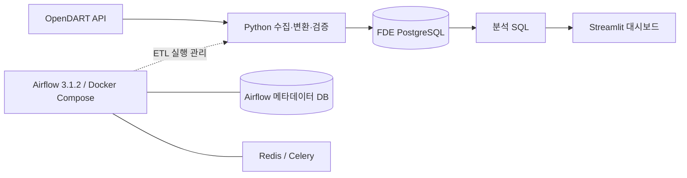

# FDE — 기업 재무 데이터 파이프라인

OpenDART의 기업정보와 재무제표를 수집하고, PostgreSQL에 저장한 데이터를 SQL과 Streamlit으로 분석하는 데이터 엔지니어링 포트폴리오입니다.

API 응답을 화면에 표시하는 데서 나아가 **수집 → 검증 → 적재 → 워크플로 실행 → 분석 → 시각화**의 전체 흐름을 구현했습니다. v1은 로컬 환경에서 이 흐름을 재현하고, 데이터 처리 방식과 개발 중 해결한 문제를 설명하는 데 집중합니다.

## 1. 구현 결과

| 항목 | 결과 |
|---|---|
| 기업정보 | 3,998개 기업 적재 |
| 재무제표 | 5개 기업의 2025년 연결재무제표(CFS), 계정 행 1,281건 적재 |
| 수집 대상 | 삼성전자, SK하이닉스, 현대자동차, NAVER, LG전자 |
| 보고서 | 사업보고서(`reprt_code=11011`) |
| 워크플로 | Airflow DAG의 태스크 4개 실행 성공 |
| 대시보드 | 기업별 재무지표 표 및 매출액·영업이익·영업이익률 차트 표시 |

위 결과는 개발 중 확인한 실행 결과입니다. 1,281건은 보고서 수가 아닌 재무제표 **계정 행 수**이며, 데이터 건수는 수집 시점과 공시 변경에 따라 달라질 수 있습니다. 별도의 처리량·응답시간 벤치마크는 수행하지 않았습니다.

## 2. 아키텍처



- **FDE DB:** Mac에서 실행하는 PostgreSQL에 기업정보·재무제표·수집 이력을 저장합니다.
- **Airflow 메타데이터 DB:** Compose의 `postgres` 서비스가 DAG 실행 등 Airflow 내부 데이터를 관리합니다.
- **Redis:** CeleryExecutor의 메시지 브로커입니다.
- **Streamlit:** 로컬 Python 환경에서 FDE DB를 조회합니다. Compose 서비스에는 포함되지 않습니다.

## 3. 기술 스택

| 기술 | 사용 목적 |
|---|---|
| Python 3.12 | API 호출, XML 파싱, 금액 변환 및 ETL 구현 |
| requests / python-dotenv | HTTP 요청과 환경변수 로드 |
| PostgreSQL / psycopg 3 | 관계형 데이터 저장, 트랜잭션, UPSERT |
| Apache Airflow 3.1.2 | 태스크 의존성, 재시도, 정기 실행 관리 |
| Docker Compose / CeleryExecutor / Redis | Airflow 실행 환경 및 작업 실행 구성 |
| SQL | 계정별 금액 집계와 재무지표 계산 |
| pandas / Streamlit | 조회 결과 변환 및 대시보드 구현 |
| pytest | 수집·검증·증분 적재 관련 테스트 코드 |

개발 기록의 FDE DB는 PostgreSQL 17이며, Compose의 Airflow 메타데이터 DB 이미지는 PostgreSQL 16입니다. 로컬 의존성은 `requirements.txt`에 기록되어 있습니다. Airflow 이미지는 `Dockerfile`에서 별도로 빌드하며, ETL에 필요한 psycopg·requests·python-dotenv를 추가 설치합니다.

## 4. 프로젝트 구조

```text
FDE/
├── dags/
│   └── fde_pipline.py              # 파일명 그대로 사용, DAG ID는 fde_daily_pipeline
├── src/
│   ├── corp_list.py                # 기업 목록 수집 및 실행 이력 기록
│   ├── collector.py                # 개별 기업 상세정보 수집
│   ├── validator.py                # 개별 기업정보 검증
│   ├── database.py                 # 기업정보 UPSERT와 실행 이력 관리
│   ├── db_config.py                # 로컬·Docker DB 설정
│   ├── financial_collector.py      # 재무제표 수집·변환·UPSERT
│   └── dashboard.py                # Streamlit 대시보드
├── scripts/migrate.py              # SQL 마이그레이션 실행기
├── sql/
│   ├── bootstrap/create_schema_migrations.sql
│   ├── migrations/                 # 001~007 스키마 변경 SQL
│   └── queries/financial_analysis.sql
├── tests/                         # 단위·DB 연동 테스트
├── docs/DEVELOPMENT_LOG.md         # 초기 개발 기록
├── data/companies.csv
├── Dockerfile
├── docker-compose.yaml
├── requirements.txt
└── README.md
```

## 5. 핵심 기능

### 기업정보 수집과 증분 적재

`corpCode.xml` 응답의 ZIP을 메모리에서 해제하고 XML을 파싱합니다. 종목코드가 있는 기업을 추출한 뒤 `corp_code`를 기준으로 기존 데이터와 비교합니다.

- 신규 기업은 INSERT합니다.
- 기업명 또는 종목코드가 변경된 기업은 UPDATE합니다.
- 변경 없는 기업은 쓰기 작업에서 제외합니다.
- 전체·신규·변경·동일 건수와 실행 상태를 `pipeline_runs`에 기록합니다.

여기서 증분 처리는 **DB에 적재하는 변경분**을 의미합니다. 기업 목록 API 응답 자체는 매번 가져옵니다.

### 재무제표 변환과 UPSERT

종목코드로 대상 기업 5개의 고유번호를 DB에서 조회하고, 기업별 전체 재무제표 API를 순차 호출합니다. 금액 문자열의 쉼표를 제거해 `Decimal`로 변환하며 빈 값과 `-`는 NULL로 처리합니다. 잘못된 금액 형식, 빈 응답, 등록되지 않은 기업은 오류로 처리합니다.

`uq_financial_statement_row` 제약조건과 `ON CONFLICT ... DO UPDATE`를 이용해 기존 행의 계정명·계정 ID·금액·통화·수집 시각을 갱신합니다. 제약조건의 구성은 다음과 같습니다.

```text
rcept_no + fs_div + sj_div + ord + account_detail
```

현재 제약조건은 NULL 값이 포함된 키의 중복까지 보장하지 않습니다. 정정공시의 새 접수번호를 기존 보고서와 통합하는 정책도 아직 구현하지 않았습니다.

### 품질 검증과 실패 처리

Airflow는 다음 순서로 실행됩니다.

```text
collect_corporations
    → validate_results
    → check_data_quality
    → collect_financial_statements
```

기업 데이터 존재 여부, 기업코드 중복, 기업명 누락, 종목코드 형식(숫자·대문자 6자리)을 검사합니다. 기업 목록 수집과 재무제표 수집 태스크는 실패 시 5분 간격으로 최대 2회 재시도합니다. 재무제표 수집은 일부 기업이 실패해도 나머지 기업을 처리한 후 태스크를 실패 처리하며, 이미 성공한 기업의 저장 결과는 유지합니다.

### SQL 재사용과 대시보드

`dashboard.py`는 `sql/queries/financial_analysis.sql`을 읽어 실행합니다. 분석 SQL을 화면 코드에 중복 작성하지 않았으며, 조회 결과는 300초 동안 캐싱합니다.

## 6. 실행 방법

아래 명령은 **프로젝트 루트**에서 실행합니다. 현재 Compose는 macOS Docker Desktop과 호스트 PostgreSQL 구성을 기준으로 작성되어 있습니다.

### 6-1. 준비

- Python 3.12, Docker Desktop과 Docker Compose
- 실행 중인 호스트 PostgreSQL과 접속 가능한 DB 계정
- OpenDART API 인증키
- FDE 스키마가 구성된 DB

```bash
python3.12 -m venv .venv
source .venv/bin/activate
python -m pip install -r requirements.txt
mkdir -p logs
```

### 6-2. 환경변수

프로젝트 루트에 `.env`를 생성하고 다음 자리표시자를 실제 로컬 값으로 교체합니다. 예시에는 실제 키나 비밀번호를 포함하지 않았습니다.

```dotenv
DART_API_KEY=YOUR_OPENDART_API_KEY
DB_HOST=localhost
DB_PORT=5432
DB_NAME=fde
DB_USER=YOUR_POSTGRES_USER
DB_PASSWORD=YOUR_POSTGRES_PASSWORD

AIRFLOW_JWT_SECRET=YOUR_GENERATED_JWT_SECRET
AIRFLOW__CORE__FERNET_KEY=YOUR_GENERATED_FERNET_KEY
AIRFLOW_UID=50000
_AIRFLOW_WWW_USER_USERNAME=YOUR_AIRFLOW_USERNAME
_AIRFLOW_WWW_USER_PASSWORD=YOUR_AIRFLOW_PASSWORD
```

키 생성 명령은 다음과 같습니다. 각각의 출력값을 대응하는 환경변수에 입력하고 외부에 공유하지 않습니다.

```bash
python -c 'import secrets; print(secrets.token_hex(32))'
python -c 'from cryptography.fernet import Fernet; print(Fernet.generate_key().decode())'
```

| 설정 | 실제 사용 방식 |
|---|---|
| `DB_HOST`, `DB_PORT`, `DB_NAME`, `DB_USER`, `DB_PASSWORD` | 로컬 ETL 및 Streamlit의 FDE DB 접속 설정 |
| `FDE_DB_HOST` | Compose가 `host.docker.internal`로 지정 |
| `FDE_DB_PORT/NAME/USER/PASSWORD` | Compose가 `.env`의 대응하는 `DB_*` 값에서 구성 |
| 컨테이너의 `DB_HOST=postgres` | Airflow 내부 DB용 설정. 호스트 FDE DB와 구분 |
| `AIRFLOW_JWT_SECRET` | 공통 `AIRFLOW__API_AUTH__JWT_SECRET` 설정으로 전달 |
| `AIRFLOW__CORE__FERNET_KEY` | Airflow 공통 암호화 키 |

`db_config.py`는 `FDE_DB_*`가 하나라도 존재하면 5개 값을 모두 요구합니다. 로컬 실행 시에는 불완전한 `FDE_DB_*`를 설정하지 않고 위 `DB_*`를 사용합니다. 대시보드는 직접 `DB_*`를 읽습니다.

`.env`는 기존 `.gitignore`에 포함되어 있습니다. API 키·비밀번호·토큰이 포함된 로그와 설정 출력은 GitHub에 올리지 않습니다.

### 6-3. DB 스키마 준비

기존 개발 DB에서는 `companies`, `pipeline_runs`, `financial_statements`, `schema_migrations`와 재무제표 UPSERT 제약조건이 필요합니다. **Compose 초기화는 Airflow 메타데이터 DB만 준비하며 호스트 FDE DB를 생성하지 않습니다.**

```bash
MIGRATION_DB_NAME=fde_test python scripts/migrate.py
```

이후 테스트 DB를 대상으로 실행하려면 `.env`의 `DB_NAME`도 `fde_test`로 설정합니다. `MIGRATION_DB_NAME`은 마이그레이션 대상만 바꿉니다.

기존 `fde` DB의 추가 마이그레이션은 실제 스키마와 `001`~`003` 베이스라인 이력이 일치하는지 확인한 뒤 실행합니다.

```bash
ALLOW_PRODUCTION_MIGRATION=true MIGRATION_DB_NAME=fde python scripts/migrate.py
```

이 명령은 **빈 `fde` DB를 처음부터 생성하는 명령이 아닙니다.** 실행기는 베이스라인 이력이 없으면 중단합니다. 실제 스키마를 확인하지 않고 이력만 등록하지 않습니다.

### 6-4. Airflow 실행

```bash
docker compose build
docker compose up airflow-init
docker compose up -d
docker compose ps
```

`airflow-init`이 정상 종료된 뒤 [Airflow UI](http://localhost:8080)에 접속하고, `.env`에 지정한 계정으로 로그인합니다. `fde_daily_pipeline`을 활성화한 뒤 수동 실행하여 태스크 4개의 성공 여부를 확인합니다.

- DAG는 최초 등록 시 일시정지 상태입니다.
- 스케줄은 `0 9 * * *`, 시작일은 `2026-10-14`, `catchup=False`입니다.
- DAG에 시간대를 명시하지 않았으므로 실행 시각은 Airflow의 기본 시간대 설정에 따릅니다. 한국시간 오전 9시로 단정하지 않습니다.
- 컨테이너에서 호스트 DB에 접속할 수 있도록 PostgreSQL의 수신 주소와 접근 허용 설정이 준비되어 있어야 합니다.

로그 확인과 종료:

```bash
docker compose logs --tail=100 airflow-worker airflow-scheduler
docker compose down
```

### 6-5. 로컬에서 ETL 실행하기

Airflow 없이 수집 로직을 확인할 때는 다음 순서로 실행합니다.

```bash
python src/corp_list.py
python -c 'from src.financial_collector import collect_target_companies_financials; collect_target_companies_financials(bsns_year=2025)'
```

`python src/financial_collector.py`의 직접 실행 경로는 삼성전자 한 곳만 수집합니다. 5개 기업을 처리하려면 위 함수 호출 또는 Airflow DAG를 사용합니다.

### 6-6. 대시보드 실행

```bash
python -m streamlit run src/dashboard.py
```

[Streamlit 대시보드](http://localhost:8501)에서 재무지표 표와 차트를 확인합니다. 데이터가 없으면 안내 메시지를 표시하고, DB 조회 실패 시 오류를 표시합니다.

## 7. 데이터와 분석 결과

| 테이블 | 역할 |
|---|---|
| `companies` | 기업 고유번호·기업명·종목코드 등 기업정보 |
| `financial_statements` | 기업·사업연도·보고서·재무제표 구분별 계정 행 |
| `pipeline_runs` | 기업 목록 수집 상태, 처리 건수, 오류 이력 |
| `schema_migrations` | 적용한 스키마 변경 이력 |

분석 SQL은 2025년 CFS 중 손익계산서(`IS`)와 포괄손익계산서(`CIS`)에서 다음 계정을 추출합니다.

| 지표 | 계정 ID / 계산 방식 |
|---|---|
| 매출액 | `ifrs-full_Revenue` |
| 영업이익 | `dart_OperatingIncomeLoss` |
| 당기순이익 | `ifrs-full_ProfitLoss` |
| 영업이익률 | 영업이익 ÷ 매출액 × 100 |

금액은 조 원 단위로 환산하고 소수점 둘째 자리까지 표시합니다. 매출액이 0이면 `NULLIF`를 통해 나눗셈 오류를 방지합니다.

현재 SQL은 기업별 `MAX(CASE ...)`로 계정을 집계하며 보고서 코드·접수번호·통화를 추가로 제한하지 않습니다. 따라서 현재 수집한 사업보고서 데이터 범위를 전제로 해석해야 합니다. 분기보고서나 정정공시를 함께 적재할 때는 보고서 선택 기준을 먼저 보완해야 합니다.

FDE DB에 연결한 SQL 도구에서 적재 결과를 확인할 수 있습니다.

```sql
SELECT COUNT(*) AS company_count FROM companies;

SELECT COUNT(DISTINCT corp_code) AS company_count,
       COUNT(*) AS account_row_count
FROM financial_statements
WHERE bsns_year = 2025
  AND fs_div = 'CFS'
  AND reprt_code = '11011';
```

### 대시보드 스크린샷

> 스크린샷 추가 예정: 기업별 재무지표 표와 매출액·영업이익·영업이익률 차트.
> 실제 화면을 `docs/images/dashboard.png`에 저장한 뒤 아래 이미지 주석을 해제합니다.

<!--  -->

## 8. 트러블슈팅

### Docker 환경의 PostgreSQL 접속 문제

로컬과 Airflow 컨테이너의 DB 접속 대상을 분리해야 했습니다. 컨테이너의 `localhost`는 Mac의 PostgreSQL을 가리키지 않으며, Airflow 내부 DB 설정과 ETL DB 설정도 구분해야 합니다.

현재 Compose는 내부 DB에 `postgres`, FDE DB에 `host.docker.internal`을 사용합니다. ETL 공통 설정은 `FDE_DB_*`로 분리했습니다. 재무제표 태스크는 아직 `DB_*`를 직접 읽는 조회 함수도 있어 태스크 내부에서 `FDE_DB_*` 값을 `DB_*`로 전달합니다.

이 과정을 통해 DB 주소뿐 아니라 **실행 위치와 환경변수의 사용 주체**를 함께 확인해야 한다는 점을 배웠습니다.

### Airflow 인증 토큰 문제

개발 중 인증 토큰 관련 오류를 경험했습니다. 현재 구성은 모든 Airflow 서비스에 동일한 `AIRFLOW__API_AUTH__JWT_SECRET`을 전달하고, Execution API 주소를 `http://airflow-apiserver:8080/execution/`로 지정합니다.

서비스별 인증 설정과 내부 통신 주소를 함께 확인했습니다. 당시 오류 로그를 문서에 보관하지 않아 구체적인 오류 코드나 단일 원인은 단정하지 않습니다. 이후 태스크 4개가 성공한 실행 결과를 확인했습니다.

## 9. 현재 한계와 다음 개선

v1의 범위는 로컬 환경에서의 수집·적재·분석·시각화입니다. 다음 개선은 재현성과 데이터 정확도에 필요한 작은 작업부터 진행합니다.

1. **초기 DB 구성 정리:** `001`의 테이블명 오타를 수정하고 빈 테스트 DB에서 전체 마이그레이션을 검증합니다.
2. **재무제표 증분 처리 보완:** 현재 수집 여부 확인 루프가 API 호출·저장 뒤에 있어 호출을 건너뛰지 못합니다. 확인 위치를 호출 전으로 옮기고, 단순 존재 여부 외에 보고서 코드와 수집 완료 기준을 정합니다. 현재 동작은 재수집 후 UPSERT입니다.
3. **분석 대상 명확화:** 보고서 코드·접수번호·통화와 정정공시 선택 기준을 SQL에 반영합니다.
4. **중복 처리 검증:** NULL이 포함된 재무제표 키와 정정공시를 테스트하고 제약조건을 보완합니다.
5. **포트폴리오 증빙 마무리:** 대시보드와 Airflow 성공 화면을 추가하고 개발 기록을 현재 태스크 4개 구성에 맞춰 갱신합니다.

대규모 분산 처리나 클라우드 운영은 이번 v1 범위에 포함하지 않습니다.
